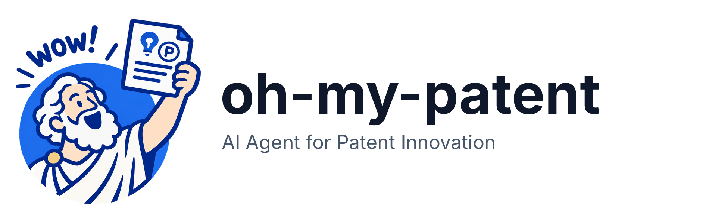

# oh-my-patent

[](https://www.npmjs.com/package/oh-my-patent)
[](https://www.npmjs.com/package/oh-my-patent)
[](./LICENSE)
[](https://www.typescriptlang.org/)
[](./README.zh-CN.md)

<p align="center">
<picture>
  <source media="(prefers-color-scheme: dark)" srcset="./assets/brand/png/logo-on-dark.png">
  
</picture>
</p>

**Meet Archimedes. Turn your “Eureka!” into a patent disclosure.**

A patent workflow toolkit for **Claude Code, Codex, and OpenCode**, available as a
plugin or a portable Agent Skill.
Archimedes orchestrates specialist agents across research, ideation, drafting,
review, and diagrams—with traceable, forkable decision paths.

## Quick start

Choose **Plugin** for Archimedes with 14 agents, 6 skills and 9 commands, or
**Skill** for one portable entry with bundled role resources and runtime.
Node.js >=22 is required. Both modes support Claude Code, Codex and OpenCode.
Run installation commands in your patent workspace.

### Plugin installation (default)

```bash
npm install -g oh-my-patent
oh-my-patent adapt install
```

The first command installs the CLI globally for project management. The second
installs the plugin configurations for Claude Code, Codex and OpenCode in the current
workspace. To install only one host, optionally append `--tool claude-code`,
`--tool codex` or `--tool opencode` to the second command.

Open the workspace in your host and select Archimedes; see the
[usage guide](docs/usage-en.md) for enabling its entry point.

<details>
<summary>Quick installation with npx</summary>

Run the installer without first installing the CLI globally:

```bash
npx oh-my-patent@latest adapt install
```

This writes the same plugin configurations to the workspace. For later CLI commands,
use `npx oh-my-patent@latest <command>` or install the CLI globally as above.

</details>

### Skill installation

Use the [Skills CLI](https://github.com/vercel-labs/skills) with Git and Node.js >=22.20:

```bash
npx skills add illusionaireal/oh-my-patent
```

The installer discovers the packaged `oh-my-patent` Skill and detects hosts.
When prompted, select Claude Code, Codex or OpenCode, **Project** scope and **Copy**
to install the complete Skill and runtime into the current workspace. Append
`--skill oh-my-patent --copy` to select the Skill and copy method explicitly.
Open the workspace in the selected host and select `oh-my-patent`.
For use across projects, append `--global` for user-level installation.
No global oh-my-patent CLI is required. This command follows the repository's
default branch; npm `@latest` follows the latest published package.

<details>
<summary>Other Skill installation methods: ZIP, project CLI and npm archive</summary>

**ZIP download — manual installation**

Open [GitHub Releases](https://github.com/illusionaireal/oh-my-patent/releases),
choose a published version and download its `oh-my-patent-skill-VERSION.zip` asset.
Copy the complete `oh-my-patent` directory inside the archive to the Skill
location for your host below. The runtime is included; no source build is needed.
The Release also includes `SHA256SUMS` for checking downloaded archives.

**oh-my-patent CLI — managed installation**

Use this method for the project's installation backups and rollback commands.
Replace `<host>` with the value for your selected host in the table:

```bash
npx oh-my-patent@latest adapt install --mode skill --tool <host>
```

| Host | Skills CLI `--agent` / project CLI `--tool` | Manual Skill location in the workspace |
| --- | --- | --- |
| Claude Code | `claude-code` | `.claude/skills/oh-my-patent` |
| Codex | `codex` | `.agents/skills/oh-my-patent` |
| OpenCode | `opencode` | `.agents/skills/oh-my-patent` |

Skills CLI also accepts `--agent <host>` to select a host explicitly. The project
CLI's Skill mode requires `--tool <host>`; plugin mode treats it as optional.

**Standalone npm archive**

Download the [standalone npm package](docs/skill.md#standalone-skill-package-installation)
for packaging or manual deployment. Extract the archive and copy the complete
`package` directory to your host's Skill location.

Keep `SKILL.md`, `references/`, `assets/` and `scripts/` together. Use the same
installation method for updates and removal; see the [installation guide](docs/skill.md).

</details>

Environment checks and host-specific manual commands: [sentinel guide](docs/sentinel.md).

### Retrieval and drawing readiness

The sentinel checks the runtime and reports research and drawing readiness separately.
Research needs an available retrieval source; academic-only retrieval requires explicit
acceptance of its limits. A configured MCP server still needs an actual host-tool check.
Existing evidence can support independent drafting or drawing while a retrieval gap is resolved.

For each figure, the workflow reuses an available saved local choice, then tries the
local preference, direct SVG or another available local renderer. Missing Mermaid
does not block startup. If the host supports timed selection, no response within
30 seconds uses the current local default; otherwise the default is immediate.
Hosts bound local rendering to 60 seconds; a recorded failure or timeout can switch
once from a local renderer to available SVG. No available local option stops that figure.
Defaults do not authorize remote calls or spending. Drafts can proceed without preview,
but final required figures need preview, current review and human acceptance.

### Start a project

Open the same workspace in your selected host. For plugin mode, select Archimedes;
for Skill mode, select `oh-my-patent`. Describe your topic, for example:

```text
Create a patent project about homomorphic encryption in privacy-preserving computing.
```

Archimedes guides you through collecting material, developing ideas, drafting the
disclosure and reviewing it. See [compatibility](docs/compatibility.md) for
host-specific requirements, and the [installation guide](docs/skill.md) for source
builds, version selection, updates and removal.

## What you can do

| Capability | What it gives you |
|---|---|
| Coordinate specialist agents | Research, ideation, patentability assessment, drafting, review, and technical responses under one orchestrator |
| Keep decisions traceable | Saved rounds, scores, innovation snapshots, and reasons in `.brainstorm/`; branch from a recorded node or restore an idea |
| Resume recorded work | Workflow state in `.patent/state.json` and agent outputs in `references/` provide context for continuing a project |
| Generate patent figures | Specifications and editable SVG, optional local rendering or approved host image tools, with provenance and current review |
| Inspect progress | CLI queries, Markdown reports, a terminal UI, and environment checks |

The project brings the disclosure, its supporting material, and its decision history
together in one project directory. Rendering engines and retrieval services have
their own setup requirements; see the [usage guide](./docs/usage-en.md).

## From idea to disclosure


*Overview of the ten stages, grouped by purpose. Arrows back to research and
drafting show where further work may be needed.*

| Step | Workflow stages |
|---|---|
| Prepare and research | `INIT` → `RESEARCH` |
| Develop and assess ideas | `BRAINSTORM_R1` → `BRAINSTORM_R2` |
| Write and illustrate | `DRAFT` → `DIAGRAM_DRAFT` |
| Review and revise | `QA_LOOP` → `FINAL_REVIEW` |
| Refresh figures and finish | `DIAGRAM_FINAL` → `DONE` |

Review can return to earlier stages. The [workflow reference](./docs/workflow-diagram-en.md)
shows the supported transitions and explains scoring decisions separately from stage changes.

## How the team works

| Pattern | Purpose |
|---|---|
| Orchestration | Archimedes coordinates specialists and carries project context between stages |
| Adversarial brainstorming | Candidate ideas receive examiner-style challenges before selection |
| Parallel evaluation | Security, compliance, and patentability specialists assess different dimensions |
| Review and response | Reviewers raise issues; the technical responder proposes document changes |
| Decision recording | The path recorder preserves rounds for comparison, branching, and recovery |

The [agent reference](./docs/agents-en.md) lists the 14 registered agents, 6 skills,
9 commands, and their roles. Actual dispatch uses the capabilities of the selected host.

## Documentation

| Read next | Contents |
|---|---|
| [Installation modes](./docs/skill.md) | Plugin and Skill setup, updates, removal and migration |
| [Release notes](./docs/releases/0.4.2.md) | Version changes and upgrade guidance |
| [Usage and CLI](./docs/usage-en.md) | Installation, platform differences, all CLI domains, and uninstall behavior |
| [Workflow](./docs/workflow-diagram-en.md) | Ten stages, review loops, and threshold behavior |
| [Agents and collaboration](./docs/agents-en.md) | Registered IDs, skills, commands, and collaboration patterns |
| [Architecture and development](./docs/architecture-en.md) | Four layers, repository layout, project files, and development commands |
| [Documentation index](./docs/README-en.md) | Bilingual guides and design references |
| [Brand guide](./assets/brand/README.md) | Archimedes artwork and usage rules |

Contributions are welcome. Read [CONTRIBUTING.md](./CONTRIBUTING.md) or
[report an issue](https://github.com/illusionaireal/oh-my-patent/issues).
Licensed under [MIT](./LICENSE).

*With thanks to the* [*LINUX DO Community*](https://linux.do/)
